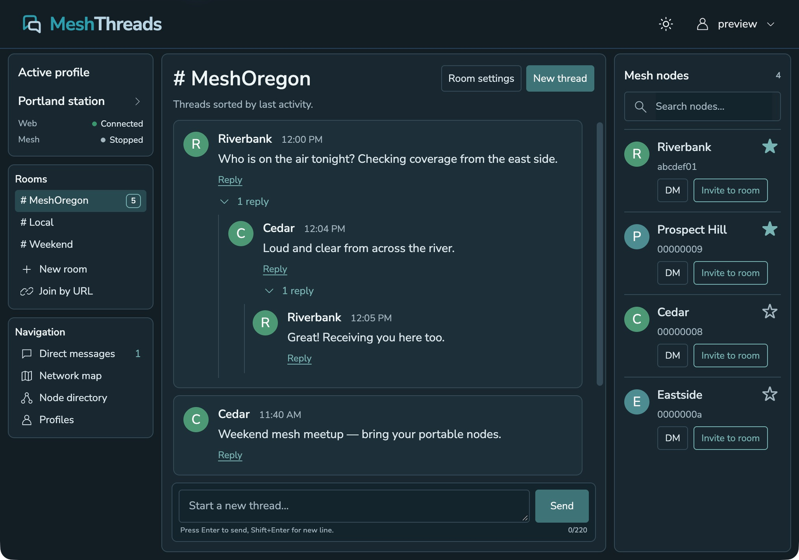
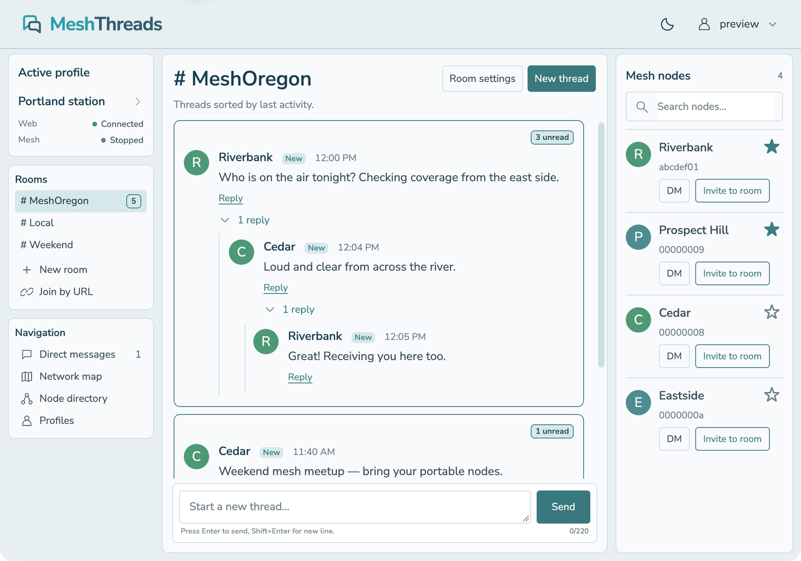
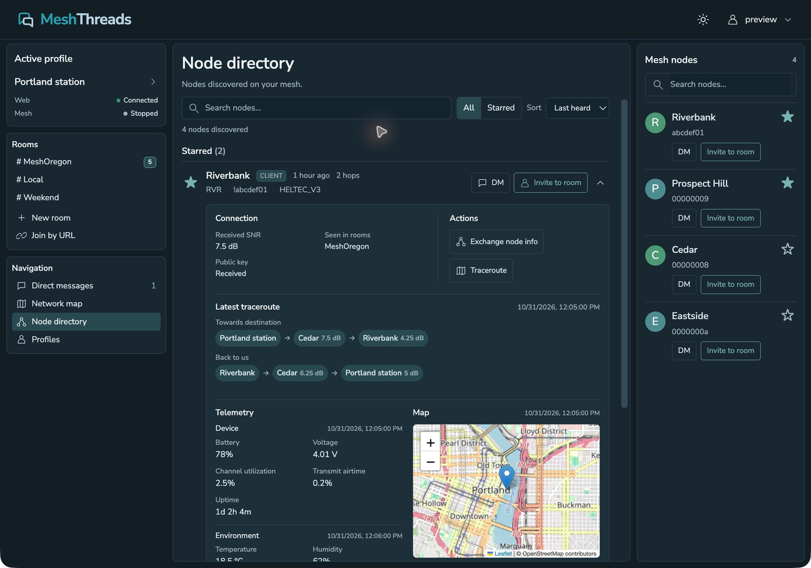
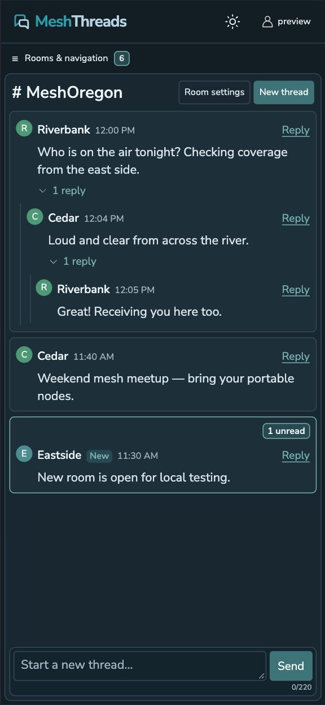
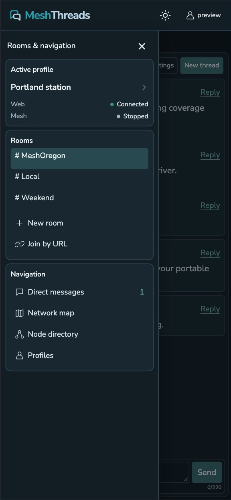

# MeshThreads

A threaded message board for Meshtastic. Rooms have their own conversations, replies nest under the message they answer, and new replies bring the whole thread back to the top.

Built from [Firefly](https://github.com/pdxlocations/firefly), using its Flask, Socket.IO, SQLite, vnode, meshdb, and UDP multicast backend. The Harbor interface has light and dark modes, compact desktop panels, and a full-width mobile board.

## Screenshots

Actual app captures using fictional sample messages, nodes, and telemetry. The sample mesh transport is stopped; these images do not represent live radio delivery.

**Threaded board, dark mode** — nested replies, room unread counts, and starred nodes.



<details>
<summary>Light mode</summary>



</details>

**Node directory** — grouped roster with expanded connection details, saved traceroute, telemetry, and position map.



Map data © [OpenStreetMap contributors](https://www.openstreetmap.org/copyright).

**Mobile** — compact conversations and an on-demand navigation drawer.

<p>
  
  
</p>

## Quick start

Python 3.11–3.14 is supported. From this folder:

```sh
python3 -m venv .venv
.venv/bin/python -m pip install -r requirements.txt
.venv/bin/python start.py
```

Open **http://localhost:5069** and create an account. The same username and password fields serve **Sign In** and **Create Account**.

1. Open **Profiles** from the account menu or navigation.
2. Create a profile with your long name, short name, and existing mesh channel name and PSK.
3. Click **Activate**. MeshThreads opens the first channel’s messages.

Profiles are virtual nodes on the mesh. Each has its own identity and channels. When an account has exactly one profile, signing in automatically activates it and opens its first channel. Accounts with zero or multiple profiles open Profiles instead. The active profile’s card provides **Deactivate**.

MeshThreads uses **Meshtastic UDP multicast**. It does not connect directly to a radio over Bluetooth or serial. Your network must deliver the multicast traffic to this machine, and the channel name and PSK must match the mesh you want to use.

## Conversations and rooms

- **Threads:** every new top-level message starts a conversation. Replies use standard Meshtastic `reply_id` metadata, and replies to replies form indented branches. Any new reply bumps the original thread to the top.
- **Expanded by default:** reply branches stay open until manually collapsed. Reply links are always visible, including on touch screens.
- **Unread activity:** room counts, thread badges, and **New** labels identify unread messages. A channel is marked read after all its loaded unread messages have been visible in a focused tab. Collapsed or offscreen replies keep the channel unread.
- **History:** older posts remain available for thread reconstruction. If an original message was never received or its history was cleared, the board labels the missing original and groups the available replies.
- **Direct messages:** conversation headers identify the other node. Delivery status and retry controls help track outgoing messages.

### Create, share, and join rooms

**New room** adds a channel to the active profile with a cryptographically random 32-byte PSK. Room names allow up to 12 UTF-8 bytes.

**Room settings** lets you rename a channel, rotate its PSK, copy its Meshtastic URL, or leave the room. Changing the name or key changes the mesh channel; share the updated link with participants. Keep at least one channel per profile. Leaving a room preserves its stored history.

**Invite to room** sends a DM containing an invitation and the selected room’s standard Meshtastic channel URL. Anyone can invite a node to a room on their active profile. The link includes the room’s PSK.

Recipients choose **Join room** before the channel is added to their active profile. **Join by URL** accepts the same links. Repeated acceptance reopens the room; links containing multiple channels are rejected to avoid importing unrelated settings. Sending an invitation queues it for transmission—check its DM delivery status for acknowledgement.

## Nodes, telemetry, and maps

The node directory uses a compact **Starred / Other nodes** roster with search, All/Starred filters, and sorting by last heard, name, or hops. Stars persist with your account across sessions and profiles.

Click a node header to expand its details. DM, invite, and star buttons keep their own actions. Clicking a node in the right-hand rail jumps to its directory entry and expands it.

Expanded details include:

- Received SNR, rooms where the node was heard, and public-key availability.
- Latest saved traceroute in both directions, including reported signal values and receipt time. Results persist per profile and destination across restarts.
- Latest stored telemetry by category: device, environment, power, air quality, radio statistics, and host metrics when reported. Missing readings are omitted, and each category shows its update time.
- An interactive map of the last reported position, with coordinates, altitude when available, and the position update time.
- **Exchange node info** and **Traceroute** actions.

Messages from unknown senders automatically trigger a node-info request after five seconds, using the active virtual profile and the received channel. If node info arrives during the delay, the request is skipped. Requests are staggered and limited to once per sender every ten minutes.

Telemetry loads when details are expanded and refreshes with directory updates. Viewing telemetry does not send extra telemetry requests over the radio. Metric definitions follow the [Meshtastic telemetry schema](https://github.com/meshtastic/protobufs/blob/master/meshtastic/telemetry.proto).

**Network map** shows nodes with reported positions. Tap a marker, then its node ID, to open that node’s directory entry.

## Desktop and mobile navigation

Desktop shows rooms on the left, conversations in the center, and nodes on the right. The sidebar displays the active profile and Web/Mesh status; tapping the profile name opens Profiles.

On phones, **Rooms & navigation** opens a compact drawer so conversations use the full screen width. Its button shows the total unread count. Choosing a destination or tapping the account name closes the drawer.

The header account menu contains **Profiles**, **Account settings**, and **Logout**. The sun/moon button switches light and dark mode and remembers your choice in that browser. Nunito Sans is bundled locally; Bootstrap, Socket.IO client, Leaflet, and map tiles require network access.

## Configuration

Firefly’s `FIREFLY_*` environment variables remain supported.

| Variable | Default for native startup |
| --- | --- |
| `FIREFLY_HOST` | `0.0.0.0` |
| `FIREFLY_PORT` | `5069` |
| `FIREFLY_MCAST_GRP` | `239.0.0.69` |
| `FIREFLY_UDP_PORT` | `4403` |
| `FIREFLY_DATABASE_FILE` | `firefly.db` |
| `FIREFLY_RUNTIME_DIR` | `firefly_runtime/` beside the database |
| `FIREFLY_SECRET_KEY` | Generated persistently when unset |

For example:

```sh
FIREFLY_PORT=5069 .venv/bin/python start.py
```

Keep the database and its matching runtime identity directory together when backing up or restoring. Do not run the same restored identity simultaneously in Firefly and MeshThreads. The [upstream documentation](docs/FIREFLY.md) covers inherited configuration and identity migration.

### Docker

```sh
docker compose up --build -d
docker compose logs -f meshthreads
```

Open **http://localhost:5069**. The service is `meshthreads`, the container is `meshthreads-app`, and the persistent volume is `meshthreads_data` with Compose’s project prefix.

The default Compose configuration uses Linux host networking for UDP multicast. Docker Desktop requires multicast-capable networking; on macOS, native Python startup gives the app direct access to LAN multicast. See [Docker setup and networking](DOCKER.md) and [.env.example](.env.example). The example environment file uses Docker paths.

## Receive diagnostics

While signed in, open `/api/network-status` to inspect receiver state, channel and port counts, decoding failures, and listener errors. It excludes message bodies and PSKs. Counters reset when the app restarts.

- `inbound_by_port` counts received traffic, excluding local UDP echoes.
- `local_echoes_by_port` reports locally sent packets echoed over UDP.
- Port `1` is text, `4` is node info, `67` is telemetry, and `70` is traceroute.

Node-info and traceroute requests choose a channel where the destination was discovered, even when another private room is open. Their status messages identify the channel used. If no inbound packets arrive during a reply test, check multicast delivery. If packets arrive but cannot be decoded on a configured channel, check its name and PSK.

Browser reconnects reload stored history so messages received during a connection interruption can reappear. End-to-end delivery still requires a reachable mesh; encrypted DMs also require the recipient’s public key.

## Checks

```sh
.venv/bin/python -m unittest discover -s tests -p 'test_*.py'
node --test tests/test_*.js
```

Tests cover identity migration, channel routing, receive handling, message snapshots, thread ancestry, room links and invitations, account isolation, favorites, saved traceroutes, telemetry, login/profile behavior, unread state, and mobile navigation. Radio transport is mocked in API tests; hardware delivery requires testing on a real Meshtastic network.

## License

MeshThreads is a Firefly derivative and retains the original [GPLv3 license](LICENSE). Nunito Sans is distributed under its [OFL license](static/fonts/OFL-NunitoSans.txt).
